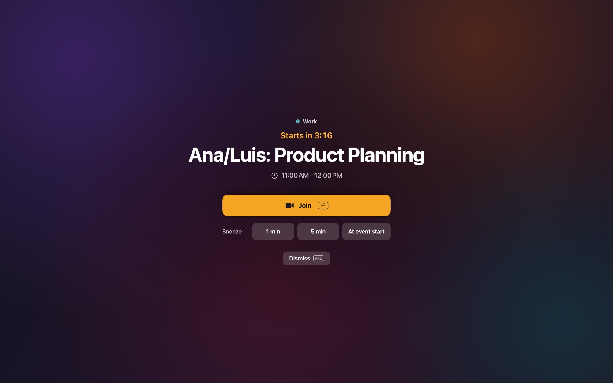
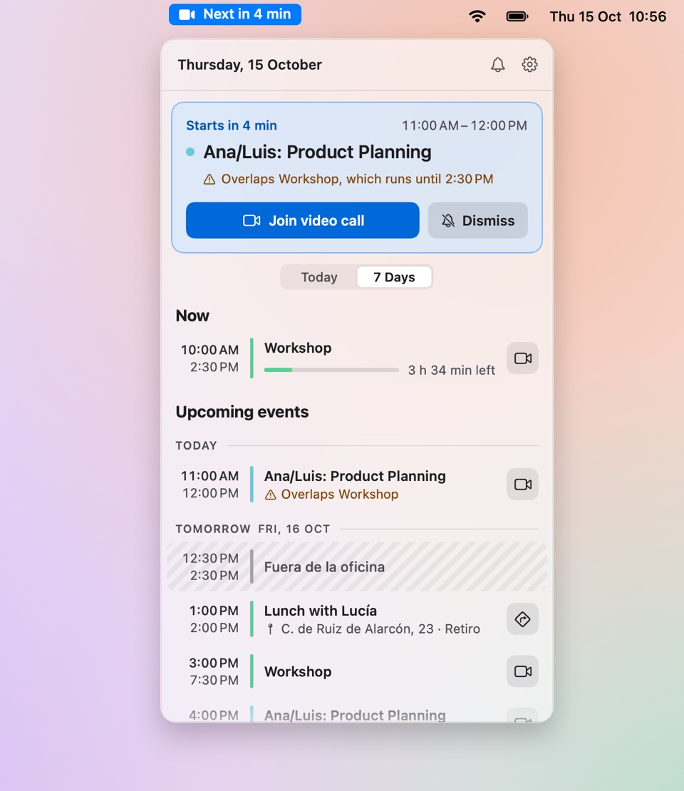
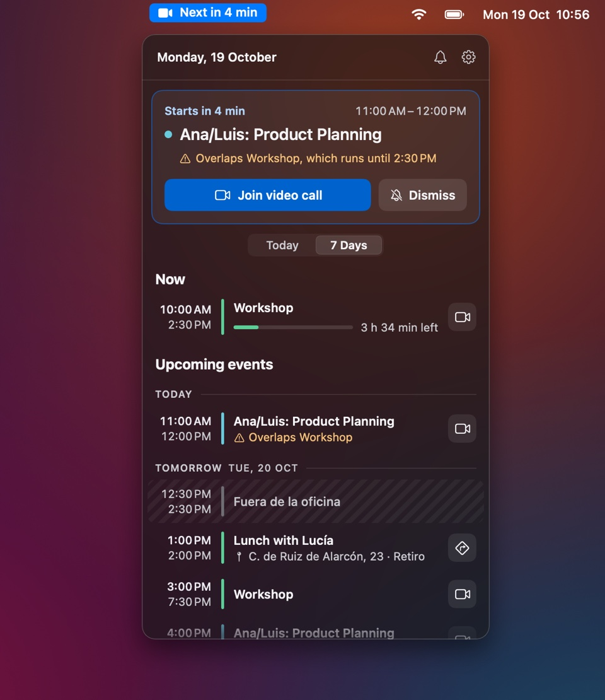
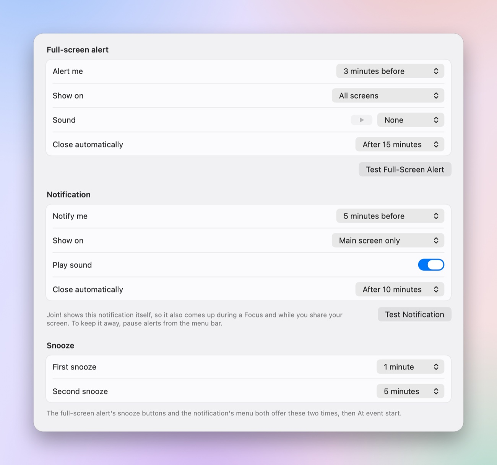
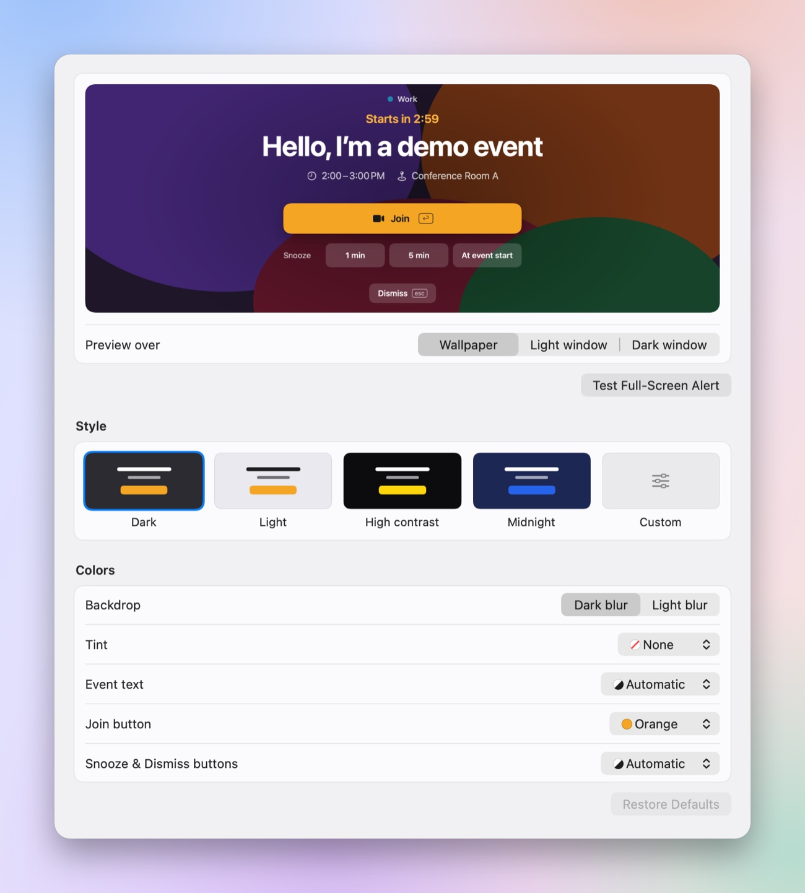

# Join!

[](#requirements)
[](Package.swift)
[](LICENSE)

A free, open-source macOS menu bar app that makes calendar meetings impossible to miss.

Join! watches the calendars on your Mac and, a few minutes before each meeting, puts a full-screen alert above everything you're doing, with a one-click button to join the call. If you'd rather get a notification, or one as well, turn it on and give it its own time. The menu bar tells you how long until your next meeting, and a panel below it shows the rest of your day.

<p align="center">
  
</p>

## Features

- **Full-screen alert** a few minutes before each meeting, on every display (or just the main one, the one with the menu bar; just the secondary ones, or the main one when it's the only display; or the one with the pointer), above everything else. It shows a live countdown, the title, time and location, and buttons to Join, snooze for one of two times or until the start (**At event start**), or Dismiss.
- **Notifications**, if you want them: a small card at the top right of the screen before each meeting, instead of the full-screen alert or as well, at its own time (**Notify me**, off until you pick a time). It counts down to the start and has a **Join** button, with a menu beside it to snooze for one of the same two times or until the start, or to dismiss it. **Join** on either one, or in the menu bar panel, takes care of both. It never takes the keyboard from what you're doing, and closes by itself after a while.
- **Menu bar item** that tells you where you are in your day: a countdown to the next meeting today ("Next in 11 h 40 min", "Next in 42 min") or its day and time ("Tomorrow at 1:00 PM", "In 3 days at 9:10 AM"), an accent pill when a meeting is about to start (5 minutes before by default), and a draining ring with "40 min left" during a meeting. Event titles are optional.
- **Menu bar panel** with one card for what matters now (starting soon, in progress, next, or nothing left today), then everything still to come today and in the coming days. Overlapping meetings are flagged, and a Today | 7 Days switch narrows the list to today. It's frosted glass that stays readable over any wallpaper or window, in light and dark mode.
- **Dismiss a meeting** from the menu bar panel, with **Dismiss** on the top card or the crossed-out bell on its row: no alerts for it (its notification closes if it's up), and the menu bar item and the card move on to what comes next. It stays in the list, greyed, until it ends, and **Restore** brings it back. For a repeating meeting, choose **This Event** or **All Future Events**.
- **One-click Join** for Google Meet, Zoom, Microsoft Teams and Webex links found in the event, and **Directions** in Apple Maps for in-person meetings.
- **Choose what counts**: tick the calendars Join! watches, and decide what happens to events nobody else is invited to (focus time, reminders you add for yourself) and to out-of-office events: show and alert, show in the list only, or exclude.
- **Pause alerts** from the bell in the menu bar panel, for an hour, until tomorrow, or until you resume: no full-screen alert and no notification meanwhile. Or set **Alert me** (and **Notify me**, if you turned it on) to **Never** to turn alerts off and keep just the menu bar item and its panel.
- **Settings**, which opens in front of every other window (from the panel's gear, with **⌘,** in the panel, or by opening Join! again), has four panes, in this order:
  - **General**: open at login; what the menu bar item shows, and when its starting-soon pill appears and in which color; what happens to events with no participants and to out-of-office events; updates.
  - **Alerts**: both kinds of alert. The full-screen alert's time, screens, sound and auto-close, with **Test Full-Screen Alert**; the notification's time, screens, sound and auto-close, with **Test Notification**; and the two snooze times both kinds share.
  - **Calendars**: which calendars Join! watches.
  - **Appearance**: the full-screen alert's look. Four styles plus a Custom one that keeps your own, a light or dark backdrop, and tint, event text and button colors picked from named swatches or any color, with contrast warnings, a live preview and **Test Full-Screen Alert**.
- **Updates in the app**: once a day Join! asks GitHub whether there's a new release. When there is, the menu bar panel says so ("Join! 1.4.0 is available"), and **Install** downloads it and checks it. Join! then says "Install 1.4.0" and keeps running until you click **Install and Relaunch**, which replaces the app and relaunches it. A switch in Settings turns the daily check off.

Works with any calendar your Mac knows about (Google, iCloud, Exchange, Outlook, CalDAV) through macOS Calendar. Native Swift and SwiftUI, no third-party dependencies.

<p align="center">
  
  
</p>
<p align="center">
  
  
</p>
<p align="center"><sub>Screenshots show sample meetings, not a real calendar.</sub></p>

## Privacy

Join! reads your calendars on your Mac through Apple's EventKit and keeps them there: nothing about your calendars or meetings leaves your Mac. Its notifications are its own windows, drawn on your Mac. It has no accounts and no analytics.

It goes online only for updates. About once a day it sends one request to GitHub's API (`api.github.com`) asking for the latest Join! release. If that request fails, it tries again an hour later, or at the next launch. While an update is on offer, it also asks again each time Join! launches, to make sure the offer still stands. The only thing the request says about you is which version of Join! you run, in its User-Agent: its other headers, including a fixed English language header (`Accept-Language: en`), are the same on every Mac. GitHub also sees your IP address. To stop these checks, turn off **Check for updates automatically** in **Settings › General › Updates**; **Check Now** there still checks when you ask. **Install** downloads the new version from the project's [GitHub Releases](https://github.com/Poliuk/join/releases), with the same User-Agent and language header.

Links only open, in your browser or Apple Maps, when you click Join, Directions or Download Page.

## Requirements

- macOS 14 Sonoma or later, on an Apple silicon or Intel Mac
- To build and test: Swift 6.2 or later, from Xcode 26 or later (Xcode 27 included) or the matching Command Line Tools (`xcode-select --install`). The tests use Swift Testing, which comes with both. The Command Line Tools for Xcode 27 alone build the app against the macOS 26.5 SDK they also install, which `make` picks by itself ([Development](#development)).

## Install

Download **[Join.zip](https://github.com/Poliuk/join/releases/latest/download/Join.zip)** from the [latest release](https://github.com/Poliuk/join/releases/latest), open it, and move **Join.app** to your Applications folder. It runs on Apple silicon and Intel Macs. The app lives in the menu bar only; there is no Dock icon. Opening the app again while it runs opens Settings, in front of other windows.

Join! is signed ad hoc but not notarized by Apple, so the first time you open a downloaded copy, macOS stops it ("Apple could not verify “Join” is free of malware…"):

1. Click **Done**.
2. Open **System Settings › Privacy & Security**, scroll down to **Security** and click **Open Anyway** next to "“Join” was blocked…". Confirm.

On macOS 14 Sonoma you can instead right-click Join.app and choose **Open**. You do this once for each version you download yourself; updates installed from inside Join! skip it.

### Updates

From 1.1.0 on, Join! checks for a new release once a day. When it finds one, the menu bar panel shows "Join! 1.4.0 is available" with **Install**, which downloads the new version from GitHub and checks it. From 1.3.0 on, nothing is replaced and nothing quits at that point: the panel then says "Install 1.4.0", with **Install and Relaunch**, and only that click replaces the app and relaunches Join!. If you quit Join! before clicking it, nothing is installed and the download is deleted; the next launch offers the update again. Copies on 1.1.x and 1.2.x still replace the app and relaunch as soon as the download is checked, so the update to 1.3.0 itself works that way. Join! downloads updates itself, so macOS doesn't quarantine them and there's no Open Anyway step. If Join! can't replace itself, for example because it runs from a folder you can't write to, **Install and Relaunch** puts the new version in `~/Downloads/Join 1.4.0/` instead, shows it in Finder and says "Quit Join!, then move Join! 1.4.0 to Applications". A release that needs a newer macOS than yours is still offered, because GitHub doesn't say which macOS a release needs; once Install finds out, Settings says "Join! 2.0.0 needs macOS 15.0 or later" and that release isn't offered again. **Settings › General › Updates** shows when Join! last checked, has **Check Now** and the panel's Install and Install and Relaunch buttons, and turns the daily check off.

Join! 1.0.0 doesn't check for updates, so update it by hand once: quit Join!, download the latest release, replace the app in Applications, and open it with Open Anyway as above.

Either way, macOS keeps the calendar permission: the signature is pinned to the bundle identifier, not to one build.

### Build from source

```sh
git clone https://github.com/poliuk/join.git
cd join
make run
```

It needs Xcode or its Command Line Tools ([Requirements](#requirements)). This builds `build/Join.app` for your Mac and opens it. Move it to `/Applications` to keep it. To build without launching, `make app`. A copy you built yourself opens without the Gatekeeper step, and the calendar permission survives rebuilds too.

## First launch

1. macOS asks for calendar access. Approve it. If you miss the prompt, grant it in System Settings › Privacy & Security › Calendars.
2. Click the menu bar item → the gear → **Settings** → **Calendars** and untick the calendars you don't want Join! to watch (holidays, birthdays). To leave out events nobody else is invited to, such as focus time, set **Events with no participants** to **Exclude** under **General** › **Events**.
3. The full-screen alert appears 3 minutes before each meeting. Change that with **Alert me** under **Alerts**. For a notification instead, or as well, pick a time in **Notify me** there. To see what each looks like, click **Test Full-Screen Alert** or **Test Notification**, under their boxes at the right.

### Google Calendar

Join! reads calendars through macOS, so your Google account needs to be added in **System Settings › Internet Accounts** with *Calendars* enabled. How quickly changes from Google reach your Mac is controlled in **Calendar › Settings › Accounts › Refresh Calendars**; set it to *Every minute* or *Every 5 minutes* for best results.

## What gets alerted

Join! has two kinds of alert, each with its own time in **Settings › Alerts**: the full-screen alert (**Alert me**, 3 minutes before by default) and a notification card at the top right of the screen (**Notify me**, Never by default). What follows applies to both.

Every event in the enabled calendars, except all-day events, cancelled events, events you declined, and out-of-office events (below). Tentative invitations do alert. In the menu bar and the panel's top card, though, a meeting you're attending (accepted, or your own) comes before a Maybe or unanswered one it overlaps: during a long Maybe block, the menu bar counts down to the call you accepted inside it from an hour before, shows that call while it runs, and goes back to the block afterwards.

**Settings › General › Events** has a choice for two kinds of event:

- **Events with no participants**, the ones nobody else is invited to, like focus time, reminders and holds you add for yourself. **Show and alert** by default.
- **Out-of-office events**, recognised by title ("Out of office", "Fuera de la oficina", "OOO", …; edit the words under **Out-of-office keywords**). **Show in the list only** by default.

Each can be:

- **Show and alert**: like any other event, in the menu bar panel's lists and top card, the menu bar item and its alerts.
- **Show in the list only**: in the panel's lists and nowhere else. It never alerts, and never gets the menu bar item or the panel's top card. Out-of-office events show striped.
- **Exclude**: left out everywhere, as if its calendar were unticked.

An out-of-office event nobody else is invited to is both kinds, and gets whichever choice shows less. Settings from 1.1 carry over: **Show events with no participants** off becomes Exclude. For out-of-office events, **Alert for out-of-office events** on becomes Show and alert; with it off, **Show out-of-office events in the list** on becomes Show in the list only, and off becomes Exclude.

On the full-screen alert, **Return** joins the call and **Esc** dismisses. Keys are ignored for the first moment after it appears, so a keystroke you were already typing elsewhere can't dismiss it by accident.

Its snooze buttons bring it back after one of two times, **First snooze** and **Second snooze** under **Snooze** in **Settings › Alerts** (1, 3, 5 or 10 minutes, or Custom…), or with **At event start**, when the meeting starts. The notification's menu offers the same two times, then At event start.

If a meeting starts while its alert is due (the Mac was asleep, the app was launched late), the alert comes immediately, unless the meeting started more than 5 minutes ago.

To take a break, click the bell at the top of the menu bar panel (**Pause alerts**) and pick **Pause for 1 hour**, **Pause until tomorrow** or **Pause until I resume**. While alerts are paused, no full-screen alert or notification comes; the menu bar shows a crossed-out bell and the panel says until when ("Alerts paused until 11:50 AM"), with **Resume**; the panel's bell, crossed out now (**Resume alerts**), resumes too. The pause survives a relaunch.

To skip a single meeting, click **Dismiss** on the menu bar panel's top card, or point at its row in the list and click the crossed-out bell. It gets no alerts, its notification closes if it's up, and the menu bar item and the top card move on to what comes next, while the panel still lists it, greyed and marked Dismissed, until it ends. The bell on its row, **Restore**, brings it back, alerts included if they're still due. This isn't the full-screen alert's own **Dismiss**, which only closes the alert.

For a repeating meeting, the button opens a small menu instead: **Dismiss This Event** skips just this occurrence, and **Dismiss All Future Events** skips this one and every later one, including those weeks away, until you restore them; they show in the list, greyed, as they come into the panel's 7 days. Restore asks only on a meeting that All Future Events dismissed. Any other restores at once with its bell, just that one, and other occurrences you dismissed stay dismissed. When it asks: **Restore This Event** brings back just that one (the rest of the series stays dismissed), and **Restore All Future Events** brings back that one and every later one, however they were dismissed; earlier ones stay dismissed.

To turn full-screen alerts off altogether, set **Alert me** to **Never** under **Settings › Alerts**. The menu bar item, its starting-soon pill and the panel keep working, and **Test Full-Screen Alert**, on Alerts and on Appearance, still shows one. **Show on**, **Sound** (and **Repeat until it's closed**) and **Close automatically** stay as they were, dimmed until you pick a time again to turn alerts back on. Notifications don't depend on it: **Notify me** has its own time or Never.

### Notifications

Pick a time in **Notify me** (Settings › Alerts) and Join! shows a notification that long before each meeting: a small card at the top right of the screen with the event's title, a countdown ("Starts in 5 min"), its time and its location, and a **Join** button with a chevron beside it. The chevron opens a menu: **Snooze** for each of the two snooze times ("Snooze 5 min"), **At event start** until the meeting starts, and **Dismiss**. Without a call link, the card has a **Snooze** menu instead. Join! draws the card itself, so there's nothing to allow in System Settings.

- **Join** opens the call and takes care of both kinds for that meeting: its full-screen alert won't come, or lets the meeting go if it's already up. So does **Join** in the menu bar panel.
- A snooze brings the card back later, and **Dismiss**, or the × that shows at the card's top left when you point at it, closes it for good. Either way the full-screen alert still comes at its time, so a notification 5 minutes before and the full-screen alert at the start both come. Dismissing the full-screen alert leaves the card where it is.
- The card never takes the keyboard from the app you're in, and clicking the card itself does nothing.
- **Show on** picks the screens, as for the full-screen alert: the main screen by default, or all of them, the secondary ones, or the one with the pointer.
- **Play sound** plays your alert sound from System Settings › Sound once as the card appears. It stays silent while that meeting's full-screen alert is on screen, so the two sounds don't overlap.
- **Close automatically** closes a card you haven't used, 10 minutes after it appears by default, as **Dismiss** would. Choose **Never** to keep it until you use it or the meeting ends.
- Several meetings stack, soonest on top, up to three per screen; the rest wait their turn. A card goes away by itself when its meeting is dismissed from the panel, cancelled, moved or over.
- Since Join! shows the card itself, it also comes up during a Focus and while you share your screen, like the full-screen alert. To keep it away, pause alerts from the menu bar.
- **Test Notification**, under the Notification box, at its right, shows one for a sample event, whatever **Notify me** says and even while alerts are paused. Its **Join** opens the sample event's call link, like a real one, and so does Join on **Test Full-Screen Alert**.
- Your calendars may send their own reminders for an event too (an alert set on the event, or a calendar's default alert), so with **Notify me** on you may get two notifications for one meeting: macOS's from your calendar and Join!'s card. Join! can't tell which events have them.

## Development

```sh
swift build          # debug build
make test            # unit tests (Swift Testing)
make app             # assemble build/Join.app (scripts/build-app.sh)
make icon            # redraw Resources/AppIcon.icns after changing scripts/make-icon.swift
```

The package needs Swift 6.2 or later and builds in the Swift 6 language mode, with complete data-race checking. The tests use Swift Testing. With Xcode selected (26 or later; CI uses Xcode 26.6), plain `swift build` and `swift test` work too, with Xcode's default SDK: Xcode 27 builds against the macOS 27 SDK and CI against the macOS 26.5 SDK, so a change has to build with both. The Command Line Tools for Xcode 27 default to the macOS 27 SDK, whose SwiftUI needs a macro plugin that only Xcode ships, so with them alone the app builds against the macOS 26.5 SDK they also install. `make` and `scripts/build-app.sh` pick it by themselves (`scripts/select-sdk.sh`); `swift build` and `swift test` need it named:

```sh
SDKROOT=/Library/Developer/CommandLineTools/SDKs/MacOSX26.5.sdk swift build
```

`SDKROOT`, when set, always wins.

With the Command Line Tools' Swift 6.4, a clean `swift test` sometimes fails with "plugin for module 'TestingMacros' not found", in test files that change from run to run: Swift Build leaves Swift Testing's macro plugin off some of their compile commands. `make test` works around it; plain `swift test` needs the plugin's folder named:

```sh
SDKROOT=/Library/Developer/CommandLineTools/SDKs/MacOSX26.5.sdk swift test \
    -Xswiftc -plugin-path -Xswiftc /Library/Developer/CommandLineTools/usr/lib/swift/host/plugins/testing
```

The package has two targets:

- `JoinCore` — pure logic with no UI, EventKit or network dependency: scheduling, link detection, time formatting, preferences, which events show and alert, what the menu bar item and panel say, the full-screen alert's countdown, what a notification says and offers, colors and contrast, and which GitHub release counts as an update. This is what the tests cover. It's nonisolated, so callers decide where its code runs; only `Preferences`, which the app's views observe, is on the main actor.
- `Join` — the app: EventKit calendar service, full-screen alert windows, notifications, menu bar item and panel, Settings, and the updater. Everything in it is on the main actor unless it says otherwise ([Concurrency](docs/TECHNICAL_DESIGN.md#concurrency) in the technical design).

To check the UI against a known calendar instead of your own, quit Join! and launch it with a fixture scenario (`nothing`, `later`, `busy`, `meeting`, `maybe` or `denied`):

```sh
open --env JOIN_FIXTURE=busy build/Join.app
```

Fixture runs keep their settings in a separate defaults domain, never schedule full-screen alerts, show notification cards only for their own meetings once **Notify me** has a time in the fixture's Settings (and for **Test Notification**), show a "Fixture" marker, and quit after two hours. They don't go online for updates either: `JOIN_FIXTURE_UPDATE` picks what the update check finds: `current` (the default, no update), `available` (a fake newer version) or `failed`, and **Install** isn't available. `ready` finds a fake newer version too, and Install goes through a pretend download to the ready bar; **Install and Relaunch** then relaunches the fixture as it is, replacing nothing, and each later **Check Now** finds a newer fake version. These runs keep the check's results in memory only, so each launch checks once, straight away, whatever an earlier fixture run found. `JOIN_FIXTURE_UPDATE=live` asks GitHub for real and lets Install and Install and Relaunch replace the app the fixture runs from, for testing updates end to end.

```sh
open --env JOIN_FIXTURE=busy --env JOIN_FIXTURE_UPDATE=available build/Join.app
```

Only fixture runs listen for a few distributed notifications (`com.poliuk.join.fixture.openSettings`, `snapshot`, `togglePanel`, `showTestNotification`, `pause`, `appearance`, `checkForUpdates`, `installUpdate`, `installAndRelaunch`, …) so scripts can open windows, show a test notification, take snapshots, switch light/dark, and check for and install updates; a normal run ignores them. See [Testing strategy](docs/TECHNICAL_DESIGN.md#12-testing-strategy) in the technical design.

The [product brief](docs/PRODUCT_BRIEF.md) and the [technical design](docs/TECHNICAL_DESIGN.md) explain what the app does and how it's built.

### Releases

Commits to main never publish a release; pushing a version tag does. `make release VERSION=1.1.0` sets the version, tags `v1.1.0` on main and, after asking, pushes. GitHub Actions then runs the tests, builds a universal Join.app and attaches `Join.zip` to a new release. Installed copies of Join! 1.1.0 and later offer each new release within a day. [Releasing](docs/RELEASING.md) covers the branch model, version numbers and what to do when a release fails.

## Contributing

Issues and pull requests are welcome. Work on a branch and open a pull request against `main`; CI builds and tests it. Keep `JoinCore` free of UI, EventKit and network code, add Swift Testing tests there for new logic (`make test` runs them), and update the docs in `docs/` when behavior changes.

## License

MIT. See [LICENSE](LICENSE).
